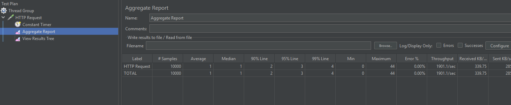

# Mục đích
- Đảm bảo call http request an toàn cho JVM

# Các bước
## Tạo thread pool
- Giới hạn số thread tạo ra tốt hơn là dồn 1 nùi

```
import java.util.concurrent.ExecutorService;
import java.util.concurrent.Executors;
import java.util.concurrent.Future;
import java.util.concurrent.Callable;

public class RequestThreadPoolManager {
    private static final int THREAD_POOL_SIZE = 100;

    // 1. Biến static giữ instance duy nhất (Bill Pugh Singleton approach / Eager initialization)
    private static final RequestThreadPoolManager INSTANCE = new RequestThreadPoolManager();

    // Khai báo ExecutorService
    private final ExecutorService executorService;

    // 2. Private constructor để ngăn việc khởi tạo từ bên ngoài bằng từ khóa 'new'
    private RequestThreadPoolManager() {
        this.executorService = Executors.newFixedThreadPool(THREAD_POOL_SIZE);
    }

    // 3. Phương thức public toàn cục để lấy instance duy nhất
    public static RequestThreadPoolManager getInstance() {
        return INSTANCE;
    }

    // 4. Phương thức push một tác vụ (không trả về kết quả) vào pool để chạy
    public void runTask(Runnable task) {
        executorService.execute(task);
    }

    // 5. (Mở rộng) Phương thức push tác vụ có trả về kết quả (dùng Callable)
    public <T> Future<T> submitTask(Callable<T> task) {
        return executorService.submit(task);
    }

    // Phương thức đóng Thread Pool khi ứng dụng tắt hẳn (tránh rò rỉ luồng)
    public void shutdown() {
        executorService.shutdown();
    }
}
```

## Tạo http client
- Chỉ 1 HttpClient là có thể tái sử dụng nếu xảy ra đồng thời cả 100 request

```
private final RequestThreadPoolManager reqPool = RequestThreadPoolManager.getInstance();
private final HttpClient httpClient = HttpClient.newHttpClient();
```

## Cách call

```
    @GetMapping("/getRecord4_withPool")
    public ResponseEntity<String> getRecord4WithPool() throws IOException, InterruptedException, ExecutionException {
        // Nghiêm cấm tạo newHttpClient ở đây
        // HttpClient httpClient = HttpClient.newHttpClient(); --> Sai
        
        HttpRequest request = HttpRequest.newBuilder()
                .uri(URI.create("http://localhost:8080/test-api/test/info"))
                .GET()
                .build();
        HttpResponse<String> response = reqPool.submitTask(
                () -> httpClient.send(request, HttpResponse.BodyHandlers.ofString()))
                .get();

        return ResponseEntity.status(response.statusCode()).body(response.body());
    }
```

# Kết quả
